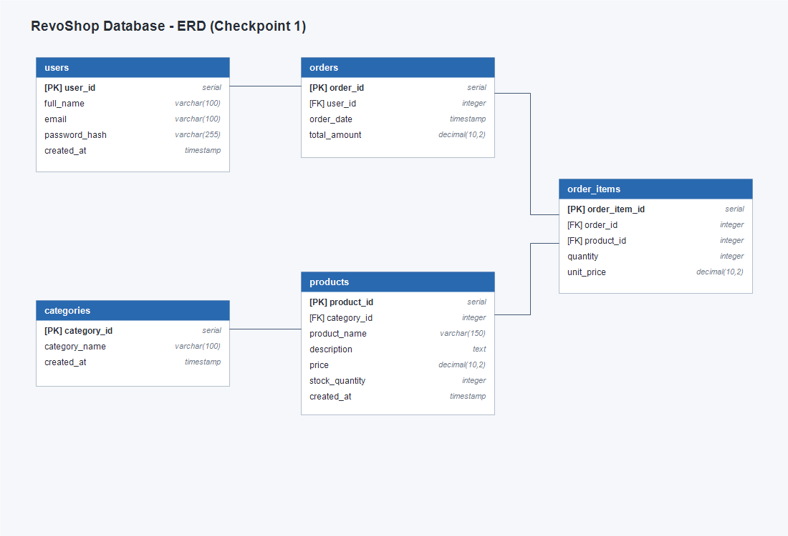

# RevoShop Database

## Description
This project contains the database design for RevoShop online store.

### Tables Included:
- `users` - Store account records (no role column yet)
- `categories` - Product categories
- `products` - Store items linked to categories
- `orders` - Orders placed by users
- `order_items` - Junction table linking orders and products (many-to-many)

## Technologies
- PostgreSQL
- pgAdmin 4
- Git & GitHub

## Database Setup (Local)

### Step 1: Install PostgreSQL
1. Download and install PostgreSQL (minimum ver. 18) from the official website.
   > [https://www.postgresql.org/download/](https://www.postgresql.org/download/)
2. During setup, set a password for the `postgres` superuser (remember this password).
3. Verify the installation in your terminal:
   ```bash
   psql -U postgres -V
   ```

### Step 2: Create Database in pgAdmin 4
1. Download **pgAdmin4**.
   > [https://www.pgadmin.org/download/](https://www.pgadmin.org/download/)
2. Open **pgAdmin 4**.
3. Connect to your PostgreSQL server using your password.
4. In the left panel (Browser tree), right-click on **Databases** > **Create** > **Database...**.
5. Enter `revoshop_db` as the Database name.
6. Click **Save** and verify that `revoshop_db` appears in the server tree.

*(Or run `CREATE DATABASE revoshop_db;` in SQL Query Tool).*

### Step 3: Run SQL Scripts
Open the **Query Tool** on `revoshop_db` and run the scripts in this order:
1. Open and run `schema.sql` (Creates all tables and relationships)
2. Open and run `seed.sql` (Inserts realistic sample data)
3. Open and run `queries.sql` (Tests queries with WHERE, ORDER BY, and LIMIT)

## Verify Tables
You can verify that data has been loaded by running:
```sql
SELECT * FROM users;
SELECT * FROM categories;
SELECT * FROM products;
SELECT * FROM orders;
SELECT * FROM order_items;
```

## Schema Diagram (ERD)
The entity relationship diagram can be found in `docs/erd.png`:



### Author
**Afrian Suprobo**
